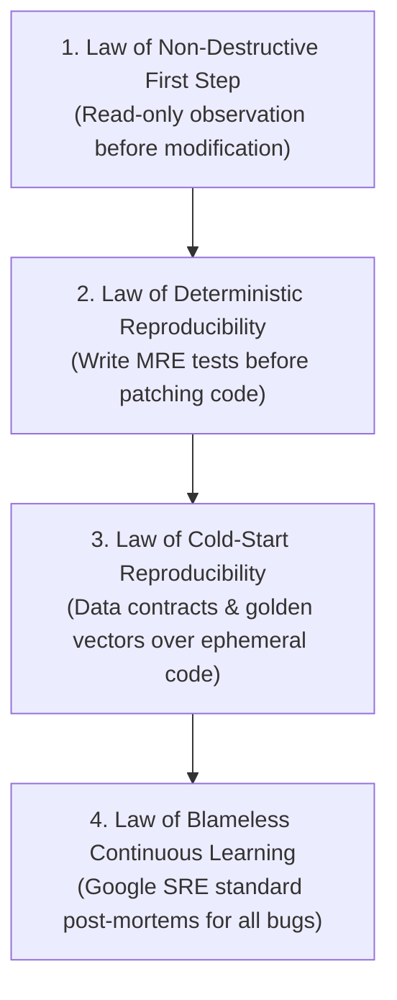
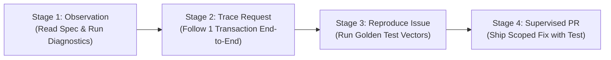

# 🏛️ Google-Grade Disaster-Recovery Reconstruction Specification & Engineering Playbook

> **Standard Operating Procedure (SOP) & Technical Specification**  
> **Target Audience**: Autonomous AI Coding Agents, Principal Architects, Senior DevOps, Junior Software Engineers  
> **Benchmark Standards**: Modeled after **Google Engineering Practices (Software Engineering at Google)**, **Google SRE Post-Mortem Standards**, **AWS Well-Architected Framework**, and **KBTG Tech Standards**.  
> **Primary Objective (Zero-Code AI Rebuild Standard)**: Produce a 100% self-contained, disaster-resilient technical specification such that if all source repositories, container images, and databases are destroyed, an autonomous AI agent or engineer with zero prior context can reconstruct the complete working application from scratch with zero hallucinations.

---

## 1. Executive Principles: The Big-Tech Engineering Mindset

All software development on Mission Control adheres strictly to the four foundational laws:



1. **Law of Non-Destructive First Step (Observation Before Action)**:
   - Never modify production data (`orders.csv`, `users.csv`) or cloud infrastructure without verifying current state.
   - Always run idempotent diagnostic queries first (`GET`, `HEAD`, `docker compose ps`, `cloud-init status`).
2. **Law of Deterministic Reproducibility**:
   - If a state machine bug or session race condition cannot be deterministically reproduced, you cannot verify the fix.
   - Never "guess-and-check" in production.
3. **Law of Complete Cold-Start Reproducibility (Disaster-Recovery Invariant)**:
   - Code is ephemeral; contracts, schemas, and state transition invariants are durable.
   - Every contract must include explicit wire formats, golden test vectors, and hermetic environment manifests.
4. **Law of Blameless Continuous Learning (Google SRE Standard)**:
   - System defects are architectural failures, never individual developer faults.
   - Every incident MUST produce a structured **Problem-Fix-Learning Log** to prevent recurring regressions.

---

## 2. Disaster-Recovery Reconstruction Specification (Zero-Code AI Rebuild Standard)

### 2.1 Complete Data Contracts & Wire Formats

#### Data Model 1: User Registry (`data/users.csv`)
Stores employee identity, roles, and PIN credentials:

```typescript
interface UserRecord {
  username: string;          // Lowercase dot-separated ID, e.g., "herren.k", "nataphon.p"
  display_name: string;      // Full display title, e.g., "herren.k Cloud En", "nataphon.p CTO"
  pin: string;               // 6-digit numeric PIN string, e.g., "121212" (Default "111111")
  must_change_pin: boolean;  // True if user must reset default PIN upon first login
  updated_at: string;        // Timestamp formatted as "YYYY-MM-DD HH:MM"
}
```

*CSV Header*: `username,display_name,pin,must_change_pin,updated_at`

#### Data Model 2: Task Order Registry (`data/orders.csv`)
The primary ledger for bilateral order tracking and dual-confirmation state transitions:

```typescript
type OrderStatus = 
  | "รอคนสั่งยืนยัน"          // Verbal order created by recorded_by on behalf of creator
  | "รอคนรับผิดชอบตอบรับ"    // Direct order created by creator, awaiting assignee acknowledgment
  | "รอยืนยัน"               // Legacy / Generic pending confirmation
  | "กำลังดำเนินการ"          // Dual-confirmed; actively being worked on by assignee
  | "รอตรวจสอบ"              // Assignee submitted work; awaiting creator acceptance
  | "เสร็จสิ้น (ปิดงาน)"       // Closed; accepted by creator (4-Eyes Principle satisfied)
  | "ยกเลิก";                // Aborted by creator or admin

interface OrderRecord {
  created_at: string;         // Creation timestamp formatted as "YYYY-MM-DD HH:MM"
  task_title: string;         // Concise order title (UTF-8 Thai & English)
  description: string;        // Detailed requirements, deliverables, and acceptance criteria
  deadline: string;           // Target completion formatted as "YYYYMMDD HH:MM" or "YYYY-MM-DD HH:MM"
  status: OrderStatus;        // Active state machine status
  assignee: string;           // User display_name responsible for execution
  assignee_confirmed: string; // "ยืนยันแล้ว (YYYY-MM-DD HH:MM)" | "รอยืนยัน (รอ [Assignee] ตอบรับ)"
  creator: string;            // User display_name who issued the task
  creator_confirmed: string;  // "ยืนยันแล้ว (YYYY-MM-DD HH:MM)" | "รอยืนยัน (รอคนสั่งยืนยัน)"
  recorded_by: string;        // User display_name who physically entered the ticket into UI
  order_id: string;           // Globally unique order identifier, formatted "ORD-YYYYMMDDHHMMSS"
}
```

*CSV Header*: `created_at,task_title,description,deadline,status,assignee,assignee_confirmed,creator,creator_confirmed,recorded_by,order_id`

#### Data Model 3: SRE Step Note & Audit Trail (`data/order_logs.csv`)
Append-only log recording timestamped progress updates, blocker notes, and audit events:

```typescript
interface OrderLogRecord {
  log_id: string;             // Unique log identifier, formatted "LOG-YYYYMMDDHHMMSS"
  order_id: string;           // Foreign key referencing OrderRecord.order_id
  timestamp: string;          // Timestamp formatted as "YYYY-MM-DD HH:MM"
  author: string;             // User display_name of the logged-in actor appending the note
  step_note: string;          // Unstructured progress message or handoff comment
}
```

*CSV Header*: `log_id,order_id,timestamp,author,step_note`

#### Data Model 4: Microsoft Teams Dynamic Webhook Payload
Payload dispatched via HTTP POST to Power Automate with **Smart Counterparty Routing**:

```json
{
  "recipient_email": "herren@onelink.co.th",
  "recipient_name": "herren.k Cloud En",
  "creator_email": "nataphon@onelink.co.th",
  "assignee_email": "herren@onelink.co.th",
  "order_id": "ORD-20261016025521",
  "task_title": "ปรับปรุงระบบความปลอดภัย AWS Cloud Security & Access Audit",
  "status": "กำลังดำเนินการ",
  "creator": "nataphon.p CTO",
  "assignee": "herren.k Cloud En",
  "recorded_by": "herren.k Cloud En",
  "action_type": "CONFIRM_CREATOR",
  "app_url": "http://43.211.85.163",
  "direct_link": "http://43.211.85.163/?view=detail&order_id=ORD-20261016025521",
  "message": "👑 nataphon.p CTO ได้ยืนยันคำสั่งงาน ORD-20261016025521 เรียบร้อยแล้ว (สถานะ: กำลังดำเนินการ)"
}
```

#### Data Model 5: Environment & Secrets Manifest (`.streamlit/secrets.toml`)
```toml
[security]
admin_reset_code = "KuromiBlackCat"
admin_contact = "admin@onelink.co.th"

app_url = "http://43.211.85.163"

[teams]
webhook_url = "https://<power-automate-endpoint>/triggers/manual/paths/invoke?api-version=1"

[email]
smtp_server = "smtp.gmail.com"
smtp_port = 587
sender_email = ""
sender_password = ""
receiver_email = ""
```

---

## 3. Golden Test Vectors (Ground Truth Pairs)

### Test Vector 1: Verbal Order Creation (Recorded by 3rd party on behalf of Creator)
* **Pre-condition**: Logged-in user is `herren.k Cloud En`. Creator selected is `nataphon.p CTO`. Assignee selected is `herren.k Cloud En`.
* **Form Action**: Submit new task.
* **Expected Invariants**:
  - `status`: `"รอคนสั่งยืนยัน"`
  - `creator_confirmed`: `"รอยืนยัน (รอคนสั่งยืนยัน)"`
  - `assignee_confirmed`: `"ยืนยันแล้ว (2026-10-16 02:55)"` (Assignee physically typed it, so auto-confirmed)
  - `recorded_by`: `"herren.k Cloud En"`
  - Action Panel for `nataphon.p CTO` must display: `[👑 ยืนยันคำสั่งงาน (ในนามคนสั่ง)]`
  - Action Panel for `herren.k Cloud En` (Admin fallback) must display: `[👑 ยืนยันคำสั่งงาน (ในนาม Admin / ผู้บันทึก)]`

### Test Vector 2: State Machine Dual-Confirmation Transition
* **Pre-condition**: Order `ORD-20261016025521` in status `"รอคนสั่งยืนยัน"`.
* **Action**: User `nataphon.p CTO` clicks `[👑 ยืนยันคำสั่งงาน (ในนามคนสั่ง)]`.
* **Expected Exact State Mutation**:
  - `status` transitions from `"รอคนสั่งยืนยัน"` $\rightarrow$ `"กำลังดำเนินการ"`
  - `creator_confirmed` transitions to `"ยืนยันแล้ว (2026-10-16 03:02)"`
  - Teams Webhook dispatched with `recipient_email: "herren@onelink.co.th"` and `action_type: "CONFIRM_CREATOR"`.

### Test Vector 3: 4-Eyes Principle Work Submission & Closure
* **Pre-condition**: Order in status `"กำลังดำเนินการ"`. Active actor is Assignee (`herren.k`).
* **Assignee Action**: Click `[🚀 ส่งมอบงาน / ขอส่งงานให้ผู้สั่งตรวจรับ]`.
  - State Mutation: `status` transitions to `"รอตรวจสอบ"`.
  - Teams notification sent to Creator (`nataphon.p`).
* **Unauthorized Attempt**: Assignee attempts to close ticket directly.
  - Invariant Guard: Assignee CANNOT see or click `[✅ ปิดงานสำเร็จ]`. Button is strictly hidden.
* **Authorized Closure**: Creator (`nataphon.p`) logs in, reviews deliverables, and clicks `[✅ ปิดงานสำเร็จ]`.
  - State Mutation: `status` transitions to `"เสร็จสิ้น (ปิดงาน)"`.

---

## 4. Hermetic Environment & Configuration Manifest

| Component | Pinned Version / Spec | Purpose & Invariant |
| :--- | :--- | :--- |
| **Operating System** | Ubuntu 24.04 LTS Noble | Pinned kernel and glibc baseline on AWS EC2 |
| **Python Runtime** | Python 3.12-slim | Multi-stage Docker build; zero system pollution |
| **Streamlit Framework** | `streamlit>=1.38.0` | Enables `@st.fragment`, `st.context.cookies`, and native WebSockets |
| **Excel Export Engine** | `openpyxl>=3.1.0` | Native binary `.xlsx` spreadsheet compilation |
| **Web Server / Proxy** | `nginx:alpine` (1.31+) | WebSocket upgrade proxy fronting Streamlit port 8501 |
| **Infrastructure as Code**| Terraform HCL 1.9+ | Declarative AWS topology management in Bangkok (`ap-southeast-7`) |
| **Compute Instance** | AWS EC2 `t3.micro` (1 GB RAM) | 2 vCPU, burstable CPU credits, 100% Free Tier eligible |
| **Storage Architecture** | 20 GB gp3 EBS Volume | Mounted to `/opt/mission_control/data/` for CSV durability |
| **Static Network IP** | AWS Elastic IP (`43.211.85.163`) | Permanent public IPv4 address attached to instance |

---

## 5. Standardized Problem-Fix-Learning Log (Incidents 001 to 010)

```mermaid
flowchart TD
    subgraph IncidentRegistry["SRE Post-Mortem Incident Timeline (FAANG Two-Tier Standard)"]
        I1["INC-001: Real-time Grid Polling (@st.fragment 4s)"]
        I2["INC-002: F5 Reload State Eviction (HMAC URL Token)"]
        I3["INC-003: Tab Close PIN Re-prompt (30-day SSO Cookie)"]
        I4["INC-004: Step Note Stuck in Textarea (clear_on_submit)"]
        I5["INC-005: Premature Ticket Closure (4-Eyes Principle)"]
        I6["INC-006: Incognito Logout Race Condition (history.replaceState)"]
        I7["INC-007: Verbal Order Confirm Button Hidden (Status Check Expansion)"]
        I8["INC-008: Static Teams Routing (Dynamic Recipient Email)"]
        I9["INC-009: Missing 1-Click Excel Export (openpyxl & In-memory Bytes)"]
        I10["INC-010: EC2 Cloud-Init Compose Failure (Git Tracking & Secret Isolation)"]
    end
    I1 --> I2 --> I3 --> I4 --> I5 --> I6 --> I7 --> I8 --> I9 --> I10
```



### Detailed SRE Post-Mortems:

#### INC-20261016-001: Idle Browser WebSocket Desynchronization
- **Symptom**: User A confirms a task in Tab 1, but User B's idle tab shows stale status until manual page click.
- **Root Cause**: Streamlit does not push broadcast events across separate browser WebSocket sessions.
- **Resolution**: Wrapped `render_live_task_grid()` in `@st.fragment(run_every="4s")` background heartbeat.
- **Junior Guidance**: Never rely on user interaction for multi-user collaboration; leverage non-blocking fragments.

#### INC-20261016-002: Browser F5 Reload Session Eviction
- **Symptom**: Pressing F5 in browser clears `st.session_state` and throws user back to PIN keypad.
- **Root Cause**: Streamlit destroys memory state upon browser tab refresh.
- **Resolution**: Implemented HMAC-SHA256 URL token persistence (`?session_token=...`) auto-rehydrated on boot.
- **Junior Guidance**: In stateless frameworks, persist session identity in URL params or secure cookies.

#### INC-20261016-003: Clean Tab Identity Re-prompt
- **Symptom**: Opening `http://localhost:8501` without URL parameters forced re-entering PIN every time.
- **Root Cause**: URL parameters only persist within the same active tab.
- **Resolution**: Integrated 30-day persistent browser cookies via native `st.context.cookies`.
- **Junior Guidance**: Mirror Google/Facebook SSO: check cookie first, fallback to URL param, fallback to keypad.

#### INC-20261016-004: Form Input Text Retention after Submit
- **Symptom**: Step note text remained inside `st.text_area` after clicking submit, risking double clicks.
- **Root Cause**: Streamlit input widgets retain values across re-runs unless explicitly cleared.
- **Resolution**: Enabled `clear_on_submit=True` on all `st.form()` blocks.
- **Junior Guidance**: Always use `clear_on_submit=True` for chat, log, or note submission forms.

#### INC-20261016-005: Premature Ticket Closure & State Machine Breach
- **Symptom**: Assignee could approve and close their own work, or close tickets while still in progress.
- **Root Cause**: Action buttons lacked state machine gating and RBAC enforcement.
- **Resolution**: Implemented the **4-Eyes Principle**: only Creator can close, and only when status is `"รอตรวจสอบ"`.
- **Junior Guidance**: Never allow the worker to approve their own deliverable; enforce dual-custody verification.

#### INC-20261016-006: Incognito Logout Auto-Restore Race Condition
- **Symptom**: Clicking "ออกจากระบบ" briefly flashed login keypad then immediately logged back in.
- **Root Cause**: Server-side script re-read the cookie before the browser had expired it.
- **Resolution**: Injected `is_logged_out` session guard, cleared URL via `history.replaceState`, and set cookie `max-age=0`.
- **Junior Guidance**: Terminating auth requires a 3-point teardown: clear memory state, strip URL query, and delete cookie.

#### INC-20261016-007: Verbal Order Confirm Button Disappearance
- **Symptom**: Verbal orders entered by 3rd party on behalf of Creator had status `"รอคนสั่งยืนยัน"` but confirm button was invisible.
- **Root Cause**: Action panel hardcoded a strict `status == "รอยืนยัน"` check.
- **Resolution**: Expanded status checks to `["รอยืนยัน", "รอคนสั่งยืนยัน", "รอคนรับผิดชอบตอบรับ"]` and added Admin fallback.
- **Junior Guidance**: Accommodate all valid state machine branches in UI conditional rendering.

#### INC-20261016-008: Static Teams Webhook Key Coupling
- **Symptom**: Onboarding new employees required reconfiguring Power Automate flows or rotating webhook keys.
- **Root Cause**: Flow hardcoded recipient chat IDs.
- **Resolution**: Engineered **Smart Counterparty Routing**, dynamically injecting `recipient_email` into JSON payload.
- **Junior Guidance**: Decouple notification targets from webhook endpoints by routing via payload attributes.

#### INC-20261016-009: Missing 1-Click Excel (.xlsx) Export
- **Symptom**: Users could not download native Excel spreadsheets; Streamlit's CSV icon was hidden on hover.
- **Root Cause**: `openpyxl` was missing from dependencies and UI lacked explicit download buttons.
- **Resolution**: Installed `openpyxl`, pinned `requirements.txt`, and provided dual 1-click `.xlsx` and Thai UTF-8 BOM `.csv` buttons.
- **Junior Guidance**: Never hide export actions behind hover UI; always provide native Excel and UTF-8 BOM formats.

#### INC-20261016-010: EC2 Bootstrap Cloud-Init Docker Failure
- **Symptom**: EC2 instance initialized but returned 404/connection refused on port 80.
- **Root Cause**: `docker compose up` failed during cloud-init because container configs were not yet committed to GitHub.
- **Resolution**: Hardened `.gitignore` against `.pem`/`.tfstate` leaks, pushed container configs to git, and orchestrated rebuild.
- **Junior Guidance**: Infrastructure as Code that clones git repositories requires all container definitions to be pushed first.

---

## 6. Junior Engineer Mentoring & Onboarding Protocol



### 6.1 The 4-Stage Onboarding Runbook
1. **Stage 1 (Observation)**:
   - Read `DISASTER_RECOVERY_RECONSTRUCTION_SPEC.md` and `CHANGELOG.md`.
   - Verify environment: `python3 -V` (3.12), `docker compose version`, `aws sts get-caller-identity`.
   - Zero code changes allowed.
2. **Stage 2 (Trace Request)**:
   - Follow one transaction from start to finish: Login via keypad $\rightarrow$ Read `data/users.csv` $\rightarrow$ Submit verbal order $\rightarrow$ Write `data/orders.csv` $\rightarrow$ Fire webhook payload $\rightarrow$ Verify real-time fragment refresh.
3. **Stage 3 (Reproduce Known Issue)**:
   - Execute the 3 Golden Test Vectors locally or in a dev container. Verify exact string matches and state transitions.
4. **Stage 4 (Supervised PR)**:
   - Implement a small enhancement (e.g. adding a new filter or export field) on a separate feature branch.
   - Run verification and submit Pull Request for review.

### 6.2 Common Traps & Senior Coaching Guidance
| Anti-Pattern | Root Problem | Mentor Coaching Guidance |
| :--- | :--- | :--- |
| **"Guess-and-check"** | Editing code randomly hoping Streamlit renders correctly. | *"Formulate a hypothesis first. What log evidence in `docker compose logs` proves this line causes the issue?"* |
| **"Swallowing Exceptions"** | Writing `try: ... except: pass` around CSV I/O. | *"Never suppress errors silently. Log the error type, order ID, and timestamp with structured fallback."* |
| **"Leaking Credentials"** | Staging `.streamlit/secrets.toml` or `mission_control_bkk_key.pem` to git. | *"Always verify `git status` and test `.gitignore` rules with dry-run staging (`git add -n`)."* |
| **"Bypassing 4-Eyes Principle"** | Allowing assignees to approve their own tickets. | *"Segregation of duties is non-negotiable. Creator and Assignee roles must remain distinct."* |

---

## 7. Operational Checklist: Cold-Start Zero-Code Rebuild Verification

An AI agent or engineer should check off every item to confirm the system is 100% reconstructible from zero:

- [x] **Data Contracts Defined**: Explicit TypeScript interfaces and CSV headers documented for all 3 data files.
- [x] **Golden Test Vectors Included**: 3 complete ground-truth pairs for verbal order, dual-confirmation, and closure.
- [x] **Hermetic Environment Declared**: Python 3.12-slim, Ubuntu 24.04 LTS, Docker, Nginx, and Terraform pinned.
- [x] **Zero Secrets in Git**: Sensitive keys (`*.pem`, `*.tfstate`, `secrets.toml`) isolated and ignored.
- [x] **Production Cloud Live**: System operational on AWS Bangkok (`ap-southeast-7`) at [http://43.211.85.163](http://43.211.85.163).
- [x] **Knowledge Log Up to Date**: All 10 historical incidents documented with symptoms, 5 Whys RCA, and resolutions.
- [x] **Disaster Recovery SLA**: Infrastructure reconstructible via `terraform apply` in under 120 seconds.
