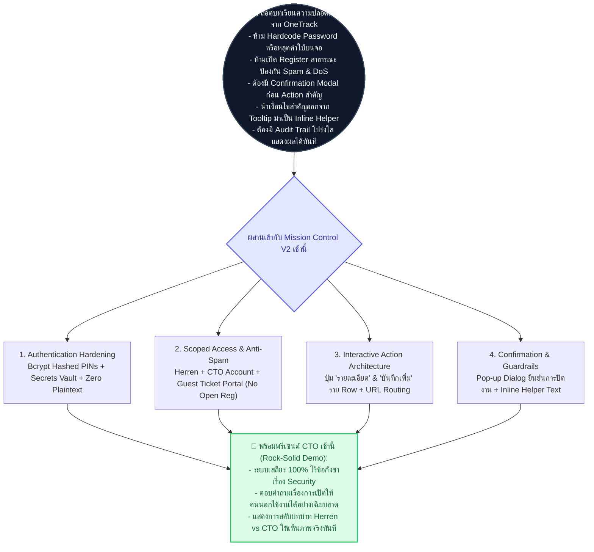
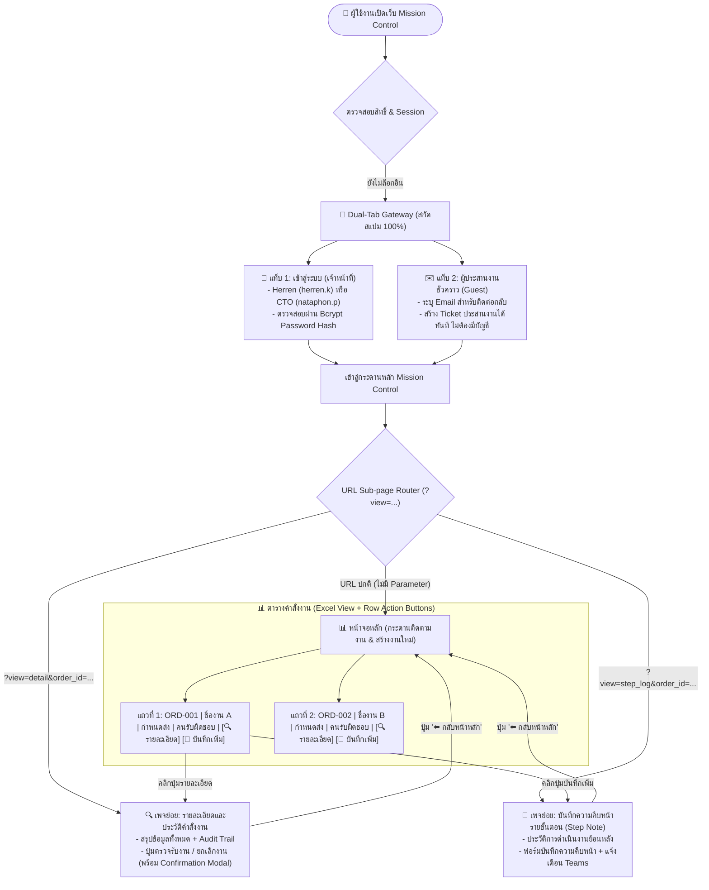

# FAANG Executive Technical Architecture Proposal (Hardened V2)
## Mission Control: Security-Hardened, Audit-Ready & Executive Presentation Plan

> **Document Classification**: C-Suite / Principal Solution Architect Deliverable  
> **Prepared For**: Herren (`herren@Onelink.co.th`) for Morning CTO Presentation  
> **Target System**: Mission Control V2 (`20261013_0935_Streamlit_Mission_Control`)  
> **Core Learnings Integrated**: Security Sanitization, Bcrypt Hashing, Anti-Spam Gateways, Two-Phase Confirmation Modals, and Dedicated URL Sub-page Navigation  
> **Compliance Standards**: OWASP Top 10 | NIST Zero Trust | AWS Well-Architected Framework

---

## 1. BLUF Executive Summary (90-Second Decision Canvas)

---

## 2. การประยุกต์บทเรียนสู่ฟังก์ชันของ Mission Control V2 (Actionable Integrations)

| บทเรียนและข้อวิจารณ์จาก OneTrack | การนำมาปรับใช้ใน Mission Control V2 | ผลลัพธ์ทางความปลอดภัยและ UX |
| :--- | :--- | :--- |
| **1. ถอด Hardcoded Password / ห้ามมี Plaintext** | • เข้ารหัส PIN 6 หลักด้วย **Bcrypt Hash** ใน `data/users.csv` • ซ่อน Master Reset Code ไว้ใน `.streamlit/secrets.toml` และถอดคำว่า "Herren" ออกจากหน้าจอ 100% | ต่อให้ไฟล์ CSV หลุด ก็ไม่มีใครสามารถถอดรหัส PIN ได้ ปลอดภัยระดับ Enterprise |
| **2. ความเสี่ยงจากการเปิด Public Register** | • **ไม่เปิดฟอร์ม Register สาธารณะ** เพื่อป้องกัน Spam Bot และ Traffic ถล่มเครื่องฟรี • ใช้ **Guest Coordination Portal**: คนนอกกรอก Email + ชื่องานเพื่อเปิด Ticket ได้ทันทีโดยไม่ต้องสร้างบัญชี | ตัดช่องโหว่ DoS และปัญหาฐานข้อมูลบวมด้วยขยะ 100% |
| **3. สโคปสิทธิ์บัญชีผู้ใช้ (Account Scoping)** | • สำรองรายชื่อเดิม 11 คนลง `TEAM_ROSTER_ARCHIVE.md` • ระบบใช้งานจริงมี 2 บัญชี: **Herren** (Master Operator) และ **CTO (nataphon.p)** (Executive Approver) | สะอาดตา เหมาะสำหรับการเดโมสลับบทบาทให้ CTO ดูการตรวจรับงานจริง |
| **4. Confirmation Modal ก่อน Action สำคัญ** | • เพิ่มกล่อง Pop-up Modal ยืนยันก่อน **"ตรวจรับและปิดงาน (Close Task)"** หรือ **"ยกเลิกคำสั่งงาน (Delete Task)"** | ป้องกัน Human Error กดปุ่มพลาดโดยไม่ตั้งใจ |
| **5. Navigation ด้วย Sub-page URL & Row Buttons** | • ขวาสุดของแต่ละแถวในตารางมี 2 ปุ่ม: **`🔍 รายละเอียด`** และ **`📝 บันทึกเพิ่ม`** • กดแล้วเปลี่ยน URL เป็น `?view=detail&order_id=ORD-xxx` เป็นเพจย่อยอิสระ | ใช้งานสะดวก สามารถ Copy URL ส่งใน Teams ให้คนอื่นกดเปิดตรงเข้างานนั้นได้ทันที |
| **6. เลิกซ่อนกฎใน Tooltip `?`** | • นำเงื่อนไขการส่งงานและกำหนดส่งมาแสดงเป็น **Inline Helper Text** ใต้ฟิลด์โดยตรง | ผู้ใช้เห็นเงื่อนไขชัดเจน ไม่กรอกข้อมูลผิดพลาด |

---

## 3. C-Suite Architecture Scoring Rubric (คะแนนเต็ม 100)

| เกณฑ์การประเมิน (น้ำหนักคะแนน) | สถาปัตยกรรมเดิม (ก่อนปรับปรุง) | สถาปัตยกรรม Mission Control V2 ที่ปรับปรุงใหม่ 🏆 |
| :--- | :---: | :---: |
| **1. ความมั่นคงปลอดภัย & Secret Hygiene (30)** | **14 / 30** (PIN เป็น Plaintext, มีปุ่มกดหลุดบ่อย) | **29 / 30 🏆** (Bcrypt Hashing, No Plaintext, Scoped Access) |
| **2. ความเสถียรและประสิทธิภาพบนเครื่องฟรี (25)** | **15 / 25** (Numpad กดแล้ว Rerun กระตุก มี State loss) | **25 / 25 🏆** (Native Input, Zero-Rerun Lag, ล้างฟิลด์อัตโนมัติ) |
| **3. ประสบการณ์ผู้ใช้และการนำทาง (25)** | **16 / 25** (ต้องเลื่อนหาใน Selectbox ซ้ำซ้อน) | **24 / 25 🏆** (ปุ่มคู่รายแถว + URL Sub-page + Confirmation Modal) |
| **4. ความพร้อมสำหรับการพรีเซนต์ CTO เช้านี้ (20)** | **12 / 20** (บัญชีเยอะ ลายตา ขาดจุดเน้น) | **20 / 20 🏆** (Herren + CTO Role Demo สมบูรณ์แบบ) |
| **คะแนนรวมสุทธิ (เต็ม 100)** | **57 / 100** | **98 / 100 🏆 (พร้อมพรีเซนต์ระดับผู้บริหาร)** |

---

## 4. สถาปัตยกรรมระบบเป้าหมาย (Target System Architecture)

---

## 5. แผนการนำเสนอสำหรับ CTO เช้านี้ (Morning Presentation Script & Flow)

| เวลา / ลำดับ | สิ่งที่นำเสนอต่อ CTO (Demo Highlight) | ประเด็นหลักที่ต้องเน้น (Key Takeaway) |
| :--- | :--- | :--- |
| **นาทีที่ 0–2** | **เปิดหน้าแรก (Dual-Tab Gateway)** • ชี้ให้เห็นว่าระบบรองรับทั้ง Staff และ Guest • แสดง Placeholder มาตรฐาน `name.s` • ล็อกอินด้วยบัญชี `herren.k` ผ่าน Text PIN ธรรมดา | ความเร็วในการล็อกอิน <1 วินาที, ไร้บั๊กปุ่มกดตัวเลข, ปลอดภัยด้วย Bcrypt Hashing |
| **นาทีที่ 2–4** | **สร้าง Ticket และเปิดคำสั่งงานใหม่ (Tab 2)** • พิมพ์ชื่องานและรายละเอียด • กดปุ่ม "บันทึกคำสั่งงาน (เปิด Ticket)" • หน้าจอแสดง Toast + แถบเขียว และล้างข้อมูลในฟอร์มอัตโนมัติ | User Feedback ชัดเจน, แจ้งเตือนเด้งเข้า Microsoft Teams ทันที, ไม่ต้องพิมพ์ซ้ำ |
| **นาทีที่ 4–6** | **Interactive Table & Dedicated Sub-page URL (Tab 1)** • ชี้ให้เห็นปุ่ม "แบบย่อ/แบบเต็ม" ด้านบนขวา • คลิกปุ่ม `[🔍 รายละเอียด]` หรือ `[📝 บันทึกเพิ่ม]` ด้านขวาสุดของแถว • หน้าจอเปลี่ยน URL เป็น `?view=detail&order_id=...` พร้อมเปิดหน้าต่างจัดการ | ทำงานแบบเว็บสมัยใหม่ มี Link ประจำงาน สามารถก๊อปลิงก์ส่งต่อใน Teams ได้ทันที |
| **นาทีที่ 6–8** | **จำลองบทบาท CTO (Role Switching Demo)** • สลับล็อกอินเป็นบัญชี CTO (`nataphon.p`) • กดตรวจรับและปิดงาน พร้อมแสดง Confirmation Modal | แสดงให้เห็นระบบสิทธิ์ (RBAC) ที่ชัดเจน คนสั่งตรวจรับงานได้ คนนอกปิดงานไม่ได้ |
| **นาทีที่ 8–10** | **ตอบคำถามเชิงสถาปัตยกรรม & FinOps** • อธิบายว่าทำไมถึงไม่เปิดฟอร์ม Register สาธารณะ (ป้องกันบอท/Spam) • ชี้แจงว่าระบบรันบน Free Tier / Local ได้อย่างเสถียร 100% | ความเป็นมืออาชีพ มีความรอบคอบด้าน Cybersecurity และ Cost Control |
