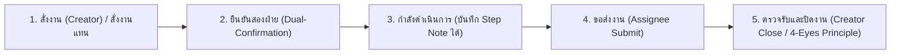

# 🚀 Mission Control: ระบบติดตามและยืนยันคำสั่งงาน

> **Enterprise Operations & Task Order Orchestration Platform**  
> พัฒนาด้วย Python 3.12, Streamlit, Docker Compose และ Nginx Reverse Proxy  
> **Production Live URL (Secure 🔒)**: **[https://d1z7r0ybkby2pf.cloudfront.net](https://d1z7r0ybkby2pf.cloudfront.net)**  
> *(Direct IP Fallback: [http://43.211.85.163](http://43.211.85.163) | Region: AWS Bangkok `ap-southeast-7`)*

---

## 📑 สารบัญวิศวกรรม (Table of Contents)
1. [ภาพรวมระบบและฟีเจอร์เด่น (Executive Overview)](#1-ภาพรวมระบบและฟีเจอร์เด่น)
2. [ตารางความเข้ากันได้ของระบบปฏิบัติการ (OS Compatibility Matrix)](#2-ตารางความเข้ากันได้ของระบบปฏิบัติการ-os-compatibility-matrix)
3. [ขั้นตอนการดาวน์โหลดและติดตั้ง (Zero-Context Onboarding)](#3-ขั้นตอนการดาวน์โหลดและติดตั้ง-zero-context-onboarding)
4. [คู่มือการรันระบบแต่ละโหมด (Multi-Mode Execution)](#4-คู่มือการรันระบบแต่ละโหมด-multi-mode-execution)
5. [การตั้งค่า Microsoft Teams Dynamic Webhook](#5-การตั้งค่า-microsoft-teams-dynamic-webhook)
6. [การตั้งค่า Secrets & Configuration (.streamlit/secrets.toml)](#6-การตั้งค่า-secrets--configuration)
7. [เอกสารวิศวกรรมมาตรฐาน FAANG ในโปรเจกต์](#7-เอกสารวิศวกรรมมาตรฐาน-faang-ในโปรเจกต์)

---

## 1. ภาพรวมระบบและฟีเจอร์เด่น



- **Bilateral Dual-Confirmation**: คำสั่งงานทุกรายการต้องได้รับการกดยืนยันจากทั้งผู้สั่งและผู้รับผิดชอบก่อนเริ่มสถานะดำเนินการ
- **4-Eyes Principle & Segregation of Duties**: ผู้รับผิดชอบ (Assignee) ส่งงานได้ แต่ไม่สามารถอนุมัติปิดงานของตนเองได้ ต้องให้ผู้สั่งงาน (Creator) หรือ Admin ตรวจรับเท่านั้น
- **Mobile PIN Keypad**: แป้นกดรหัส PIN 6 หลักสไตล์ตู้ ATM/มือถือ พร้อมการจดจำ Session อัตโนมัติ (30-day SSO Cookie)
- **1-Click Native Excel Export**: ปุ่มดาวน์โหลดข้อมูลทั้งรูปแบบ `.xlsx` (OpenPyXL) และ `.csv` รองรับภาษาไทย (UTF-8 BOM)
- **Real-Time Heartbeat**: แสดงผลตารางงานแบบเรียลไทม์ผ่าน Streamlit Fragment (`run_every="4s"`)
- **Smart Counterparty Routing**: แจ้งเตือนเข้า 1-on-1 Teams Chat อัตโนมัติโดยใช้ `recipient_email` โดยไม่ต้องเปลี่ยน Webhook URL เมื่อมีคนใหม่เข้าทีม

---

## 2. ตารางความเข้ากันได้ของระบบปฏิบัติการ (OS Compatibility Matrix)

| ระบบปฏิบัติการ (OS) | สถานะความเข้ากันได้ | สภาพแวดล้อมที่รองรับ / หมายเหตุ |
| :--- | :---: | :--- |
| **Ubuntu / Debian Linux** | 🟢 Full Native Support | ทดสอบบน Ubuntu 22.04 LTS / 24.04 LTS Noble (บน AWS EC2 และ Local) |
| **Windows 11 / 10 (WSL2)** | 🟢 Full Native Support | รันผ่าน WSL Ubuntu terminal ด้วย Docker หรือ Python venv |
| **Windows 11 / 10 Native** | 🟢 Native (PowerShell) | มีสคริปต์ `run.ps1` สำหรับตั้งค่า venv และเปิดใช้งานแบบ Turnkey 1 คลิก |
| **macOS (Apple Silicon / Intel)** | 🟢 Full Native Support | รองรับ Python 3.12 (Homebrew) และ Docker Desktop |

---

## 3. ขั้นตอนการดาวน์โหลดและติดตั้ง (Zero-Context Onboarding)

### วิธีที่ 1: ผ่าน Git Command Line (แนะนำสำหรับนักพัฒนา)
```bash
git clone https://github.com/PainWorry/20261013_0935_Streamlit_Mission_Control.git
cd 20261013_0935_Streamlit_Mission_Control
```

### วิธีที่ 2: ดาวน์โหลดเป็นไฟล์ ZIP (สำหรับผู้ใช้งานทั่วไป)
1. ไปที่หน้า GitHub Repository: [PainWorry/20261013_0935_Streamlit_Mission_Control](https://github.com/PainWorry/20261013_0935_Streamlit_Mission_Control)
2. คลิกปุ่มสีเขียว **`Code`** $\rightarrow$ เลือก **`Download ZIP`**
3. แตกไฟล์ ZIP ออกมา แล้วเปิด Terminal หรือ PowerShell ภายในโฟลเดอร์นั้น

---

## 4. คู่มือการรันระบบแต่ละโหมด (Multi-Mode Execution)

### โหมด A: Production บน AWS Cloud (เข้าใช้งานได้ทันที ปลอดภัย 🔒 มีใบรับรอง SSL)
👉 **เข้าใช้งานผ่าน HTTPS (แนะนำ)**: **[https://d1z7r0ybkby2pf.cloudfront.net](https://d1z7r0ybkby2pf.cloudfront.net)**  
*(หรือ Direct IP Fallback: [http://43.211.85.163](http://43.211.85.163))*

---

### โหมด B: รันบน Windows ด้วย Turnkey PowerShell (1-Click Run)
ดับเบิลคลิกไฟล์ `run.ps1` หรือเปิด PowerShell แล้วพิมพ์:
```powershell
powershell -ExecutionPolicy Bypass -File run.ps1
```
*สคริปต์จะตรวจสอบ Python, สร้าง `.venv`, ติดตั้ง dependencies และเปิดเบราว์เซอร์ให้อัตโนมัติ*

---

### โหมด C: รันผ่าน Docker Compose บน Linux / macOS / Server
```bash
# คัดลอก secrets.toml ตัวอย่าง
cp .streamlit/secrets.toml.example .streamlit/secrets.toml

# สั่ง Build และรันคอนเทนเนอร์ในพื้นหลัง
docker compose up -d --build

# ตรวจสอบสถานะการทำงาน
docker compose ps
```
*เปิดเบราว์เซอร์ไปที่: `http://localhost` (ผ่าน Nginx พอร์ต 80)*

---

### โหมด D: รันแบบ Manual Local Dev (Python CLI)
```bash
# 1. สร้าง Virtual Environment
python3 -m venv .venv
source .venv/bin/activate  # บน Windows: .venv\Scripts\activate

# 2. ติดตั้ง Dependencies
pip install -r requirements.txt

# 3. รัน Streamlit App
streamlit run app.py
```
*เปิดเบราว์เซอร์ไปที่: `http://localhost:8501`*

---

## 5. การตั้งค่า Microsoft Teams Dynamic Webhook

ระบบรองรับการส่งข้อความเข้าห้องแชต 1-on-1 หรือกลุ่มแชต ผ่าน Power Automate Flow:

1. เข้าไปที่ [make.powerautomate.com](https://make.powerautomate.com)
2. สร้าง Flow ชนิด **Automated cloud flow** หรือ **Instant cloud flow**
3. เลือก Trigger: **"When an HTTP request is received"**
4. เพิ่ม Action: **"Post message in a chat or channel"**
   - Post as: `Flow bot`
   - Post in: `Group chat` (หรือ `Chat with Flow bot`)
   - Recipient / Chat: กำหนดให้ดึงค่าจาก JSON Payload: `triggerBody()?['recipient_email']`
5. บันทึก Flow แล้วคัดลอก **HTTP POST URL** ไปใส่ใน `.streamlit/secrets.toml`

---

## 6. การตั้งค่า Secrets & Configuration

สร้างไฟล์ `.streamlit/secrets.toml` โดยอ้างอิงจากตัวอย่าง:

```toml
# รหัสลับสำหรับขอรีเซ็ตรหัสผ่าน (Master Reset Code)
[security]
admin_reset_code = "KuromiBlackCat"
admin_contact = "admin@onelink.co.th"

# URL ของเว็บแอป (สำหรับทำ Deep Link ใน Teams Notification)
app_url = "http://43.211.85.163"

# การเชื่อมต่อ Microsoft Teams Webhook
[teams]
webhook_url = "https://<your-power-automate-url>"

# การเชื่อมต่อ Email สำรอง (SMTP)
[email]
smtp_server = "smtp.gmail.com"
smtp_port = 587
sender_email = ""
sender_password = ""
receiver_email = ""
```

---

## 7. เอกสารวิศวกรรมมาตรฐาน FAANG ในโปรเจกต์

| ชื่อเอกสาร | ระดับผู้ใช้งาน | วัตถุประสงค์และเนื้อหาสำคัญ |
| :--- | :---: | :--- |
| **[MISSION_CONTROL_ENTERPRISE_PLAYBOOK_TH_EN.md](file:///home/herrenk/User/20261013_0935_Streamlit_Mission_Control/docs/MISSION_CONTROL_ENTERPRISE_PLAYBOOK_TH_EN.md)** | All Users / Engineers / Management | **Bilingual Master Playbook (ไทย/EN)**: วัตถุประสงค์, เครื่องมือ (Tools), โครงสร้างสถาปัตยกรรม, ผลลัพธ์, วิธีใช้งานทุกขั้นตอน, และประวัติแก้ปัญหา INC-001 ถึง 012 |
| **[MISSION_CONTROL_EXECUTIVE_WALKTHROUGH.md](file:///home/herrenk/User/20261013_0935_Streamlit_Mission_Control/docs/MISSION_CONTROL_EXECUTIVE_WALKTHROUGH.md)** | All Users / C-Suite | **Executive Visual Walkthrough**: ภาพหน้าจอจริงแสดงขั้นตอนการล็อกอิน PIN, ตารางงาน, การส่งออก Excel 1-คลิก, และแผงคำสั่งงาน |
| **[DISASTER_RECOVERY_RECONSTRUCTION_SPEC.md](file:///home/herrenk/User/20261013_0935_Streamlit_Mission_Control/DISASTER_RECOVERY_RECONSTRUCTION_SPEC.md)** | AI Agent / Senior Eng | **Zero-Code AI Rebuild Standard**: Data Contracts, Golden Vectors, Problem-Fix Log 001-012, และ Junior Mentoring |
| **[AWS_DEPLOYMENT_EXECUTIVE_PROPOSAL.md](file:///home/herrenk/User/20261013_0935_Streamlit_Mission_Control/AWS_DEPLOYMENT_EXECUTIVE_PROPOSAL.md)** | CEO / CTO / C-Suite | แผนสถาปัตยกรรมคลาวด์, การเปรียบเทียบ Region (Bangkok 96/100), FinOps 3-Tier Overrun Buffer |
| **[POST_APPROVAL_DEVOPS_RUNBOOK.md](file:///home/herrenk/User/20261013_0935_Streamlit_Mission_Control/POST_APPROVAL_DEVOPS_RUNBOOK.md)** | SRE / DevOps | คู่มือปฏิบัติการเซิร์ฟเวอร์, การเชื่อมต่อ SSH, การสำรองข้อมูล CSV, และ Disaster Recovery Runbook |
| **[CHANGELOG.md](file:///home/herrenk/User/20261013_0935_Streamlit_Mission_Control/CHANGELOG.md)** | Lead / Auditor | บันทึกประวัติการแก้ปัญหาทั้งหมด (INC-001 ถึง INC-012) ตามมาตรฐาน FAANG Hybrid Two-Tier Standard |
| **[CHAT_LOG.md](file:///home/herrenk/User/20261013_0935_Streamlit_Mission_Control/docs/chat_logs/CHAT_LOG.md)** | Developers / Auditors | **Full Conversation Log**: ประวัติการสนทนาและคำสั่งพัฒนาระบบทั้งหมดตั้งแต่ต้นจนจบพร้อม Raw JSONL |
