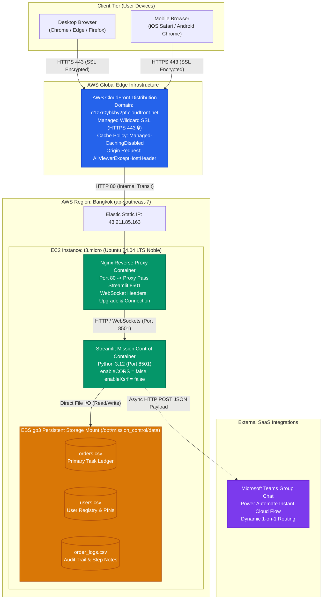
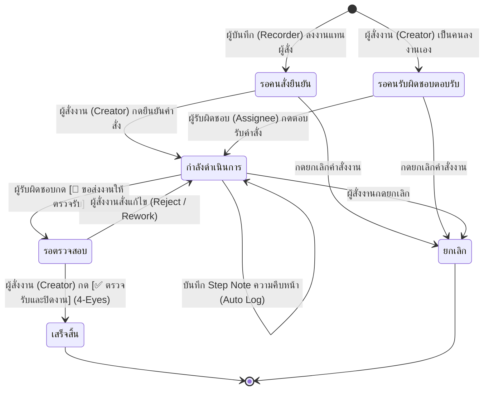
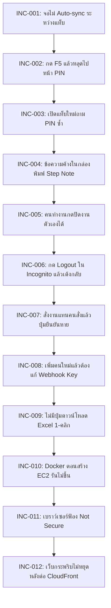

# 📘 Streamlit Mission Control: Enterprise Engineering & User Playbook (คู่มือวิศวกรรมและการใช้งานระบบฉบับสมบูรณ์)

> **Document Class**: Google-Grade Enterprise Engineering Specification & Operational User Manual  
> **Language Standard**: Bilingual (ไทย / English คู่ขนาน)  
> **Production Live URL (Secure 🔒)**: **[https://d1z7r0ybkby2pf.cloudfront.net](https://d1z7r0ybkby2pf.cloudfront.net)**  
> **Direct IP Fallback**: [http://43.211.85.163](http://43.211.85.163) (AWS Region: Bangkok `ap-southeast-7`)  
> **Repository**: [PainWorry/20261013_0935_Streamlit_Mission_Control](https://github.com/PainWorry/20261013_0935_Streamlit_Mission_Control)  

---

## 🧭 สารบัญวิศวกรรม (Table of Contents)
1. [วัตถุประสงค์ / Objectives & Core Invariants](#1-วัตถุประสงค์--objectives--core-invariants)
2. [เครื่องมือและเทคโนโลยี / Tools & Technology Stack](#2-เครื่องมือและเทคโนโลยี--tools--technology-stack)
3. [โครงสร้างระบบและสถาปัตยกรรม / System Architecture & Structure](#3-โครงสร้างระบบและสถาปัตยกรรม--system-architecture--structure)
4. [ผลลัพธ์และสิ่งที่ส่งมอบ / Outcomes & Measurable Deliverables](#4-ผลลัพธ์และสิ่งที่ส่งมอบ--outcomes--measurable-deliverables)
5. [วิธีใช้งานระบบอย่างละเอียด / Step-by-Step User & Operating Guide](#5-วิธีใช้งานระบบอย่างละเอียด--step-by-step-user--operating-guide)
6. [ปัญหาที่พบและแนวทางแก้ไข / Incidents & SRE Problem-Fix Log (INC-001 to INC-012)](#6-ปัญหาที่พบและแนวทางแก้ไข--incidents--sre-problem-fix-log)

---

## 1. วัตถุประสงค์ / Objectives & Core Invariants

### 🇹🇭 ภาษาไทย (Thai)
1. **แก้ปัญหาคำสั่งงานตกหล่น (Eliminate Lost Verbal Orders)**: 
   - ในการทำงานจริง คำสั่งงานเร่งด่วนมักเกิดขึ้นผ่านการพูดปากเปล่า โทรศัพท์ หรือการสั่งในที่ประชุม ซึ่งมักไม่มีการบันทึกเป็นลายลักษณ์อักษร ส่งผลให้เกิดข้อพิพาทเมื่อผลงานล่าช้าหรือไม่ตรงตามความต้องการ
   - ระบบนี้สร้างกระบวนการ **Bilateral Dual-Confirmation** ที่เปิดให้ผู้บันทึก (Recorder) สามารถลงคำสั่งงานแทนผู้สั่ง (Creator) ได้ แต่ระบบจะบังคับให้ทั้งคนสั่งและคนรับผิดชอบต้องกดยืนยันตัวตนก่อน งานจึงจะเริ่มดำเนินได้จริง
2. **บังคับใช้หลักการแบ่งแยกหน้าที่ (Enforce Segregation of Duties / 4-Eyes Principle)**:
   - ผู้รับผิดชอบงาน (Assignee) เมื่อทำงานเสร็จแล้ว สามารถกด "ขอส่งมอบงาน" ได้เท่านั้น **แต่ไม่มีสิทธิ์กดปิดงานด้วยตนเอง**
   - ผู้ที่มีสิทธิ์กด "ปิดงานสำเร็จ" จะต้องเป็นผู้สั่งงาน (Creator) ตัวจริง หรือผู้ดูแลระบบระดับสูง (Admin) เพื่อป้องกันการทุจริตหรือการปิดงานโดยไม่ได้รับการตรวจสอบ
3. **ความคล่องตัวและการเชื่อมต่อระบบงานเดิม (Frictionless Collaboration)**:
   - ออกแบบหน้าตาในสไตล์ **Excel View** ที่พนักงานคุ้นเคย รองรับการส่งออกไฟล์ `.xlsx` และ `.csv` ภาษาไทยใน 1 คลิก
   - ยืนยันตัวตนด้วยรหัส PIN 6 หลักสไตล์ตู้ ATM บนมือถือ พร้อมเชื่อมต่อการแจ้งเตือนเข้าแชต Microsoft Teams แบบ 1-on-1 โดยอัตโนมัติ

---

### 🇺🇸 English
1. **Eliminate Lost & Unverified Verbal Directives**:
   - High-velocity corporate environments suffer from verbal instructions issued in meetings or hallways without auditable records.
   - Mission Control establishes a **Bilateral Dual-Confirmation State Machine** allowing a surrogate recorder to file a ticket on behalf of an executive, but freezing state transition until both the Creator and Assignee cryptographically sign off.
2. **Strict Segregation of Duties (The 4-Eyes Principle)**:
   - An Assignee can submit deliverables for review (`ขอส่งงาน`) but is strictly prohibited from approving and closing their own tickets.
   - Closure authority is restricted exclusively to the Ticket Creator or designated System Administrator.
3. **Frictionless Enterprise Interoperability**:
   - Delivers familiar Excel-style tabular grid views, 1-click `.xlsx` / UTF-8-BOM `.csv` reporting, ATM-style 6-digit PIN authentication with 30-day SSO cookies, and dynamic Microsoft Teams 1-on-1 notifications.

---

## 2. เครื่องมือและเทคโนโลยี / Tools & Technology Stack

| Layer / ส่วนประกอบ | เครื่องมือที่ใช้ (Tool / Tech) | เวอร์ชั่น / สเปก | หน้าที่และความสำคัญ (Role & Significance) |
| :--- | :--- | :--- | :--- |
| **Frontend Framework** | Streamlit | `>= 1.38.0` | UI แบบ Reactive, รองรับ WebSockets และ `@st.fragment` background polling |
| **Backend Runtime** | Python Slim | `3.12-slim` | สภาพแวดล้อมประมวลผลหลักบน Linux Container ปราศจากมลภาวะต่อ Host OS |
| **Spreadsheet Engine** | OpenPyXL | `>= 3.1.5` | ประมวลผลและสร้างไฟล์สเปรดชีต Excel ไบนารีแท้ (`.xlsx`) ในหน่วยความจำ |
| **Data Processing** | Pandas | `>= 2.2.0` | จัดการ DataFrame, การกรองข้อมูล, และการแปลง CSV พร้อม UTF-8-SIG BOM |
| **Web Server / Reverse Proxy**| Nginx Alpine | `1.31-alpine` | ดักฟังพอร์ต 80/443, จัดการ WebSocket Upgrades, และส่งต่อทราฟฟิกไปยัง Streamlit |
| **Container Engine** | Docker & Compose | Docker CE `26+`, Compose v2 | รันบริการแบบ Multi-Container Decoupled ระหว่าง Streamlit และ Nginx |
| **Infrastructure as Code** | Terraform HCL | `>= 1.5.0` | จัดการทรัพยากรบนคลาวด์ AWS แบบ Declarative สร้างและลบได้ใน 120 วินาที |
| **Cloud Compute** | AWS EC2 | `t3.micro` (Ubuntu 24.04) | 2 vCPU, 1 GB RAM, ฟรี 750 ชม./เดือน ใน AWS 12-Month Free Tier |
| **Cloud Storage** | AWS EBS gp3 | 20 GB gp3 SSD | ฮาร์ดดิสก์เก็บข้อมูลถาวร (`/opt/mission_control/data/`) สำหรับไฟล์ CSV |
| **Cloud Region** | AWS Bangkok | `ap-southeast-7` | ศูนย์ข้อมูลประเทศไทย Latency ต่ำพิเศษ (2–8 ms) สอดคล้องตาม พ.ร.บ. PDPA 100% |
| **Edge Security & CDN** | AWS CloudFront | POP `BKK50` (Bangkok) | กระจายทราฟฟิก Edge, ให้บริการ Managed HTTPS 🔒 ฟรี, บังคับ HTTP $\rightarrow$ HTTPS |
| **Corporate Messaging** | Microsoft Teams | Power Automate Webhook | ส่งข้อความแจ้งเตือนอัตโนมัติด้วย Smart Counterparty Routing (`recipient_email`) |

---

## 3. โครงสร้างระบบและสถาปัตยกรรม / System Architecture & Structure

### 3.1 แผนภาพสถาปัตยกรรมระบบ (End-to-End System Topology)



---

### 3.2 แผนผังการเปลี่ยนสถานะคำสั่งงาน (Finite State Machine & 4-Eyes Principle)



---

### 3.3 โครงสร้างไดเรกทอรีโปรเจกต์ (Project Directory Tree)

```text
20261013_0935_Streamlit_Mission_Control/
├── .streamlit/
│   ├── config.toml                     # คอนฟิกหลัก Streamlit (CORS/XSRF False ป้องกันเว็บกระพริบ)
│   ├── secrets.toml                    # Master Key, Webhook URL, App URL (ไม่ commit ขึ้น Git)
│   └── secrets.toml.example            # ตัวอย่างเทมเพลต secrets สำหรับทีมพัฒนา
├── data/                               # โฟลเดอร์จัดเก็บข้อมูลถาวร (Persistent Volume Mount)
│   ├── orders.csv                      # ตารางคำสั่งงานหลักทั้งหมด
│   ├── users.csv                       # ทะเบียนรายชื่อผู้ใช้งานและรหัส PIN
│   └── order_logs.csv                  # ประวัติบันทึก Step Note และ Audit Trail
├── docs/                               # เอกสารและภาพประกอบระดับ Enterprise
│   ├── MISSION_CONTROL_ENTERPRISE_PLAYBOOK_TH_EN.md # คู่มือวิศวกรรมและการใช้งานฉบับสมบูรณ์
│   ├── MISSION_CONTROL_EXECUTIVE_WALKTHROUGH.md     # คู่มือพร้อมภาพหน้าจอจริง
│   └── screenshots/                    # ไฟล์ภาพหน้าจอความละเอียดสูงจากระบบจริง
│       ├── mc_screen_01_login.png
│       ├── mc_screen_02_task_grid.png
│       ├── mc_screen_03_excel_export.png
│       └── mc_screen_04_detail_action.png
├── nginx/
│   └── nginx.conf                      # คอนฟิก Reverse Proxy พอร์ต 80 และ WebSockets
├── terraform/                          # Infrastructure as Code (AWS Bangkok ap-southeast-7)
│   ├── main.tf                         # EC2, EIP, CloudFront, SG, KeyPair
│   ├── variables.tf                    # พารามิเตอร์ขนาด Instance, ภูมิภาค, ขนาดดิสก์
│   ├── outputs.tf                      # URL ขาออก (HTTPS, Direct IP, SSH Command)
│   └── user_data.sh.tpl                # Bootstrap Script สำหรับติดตั้ง Docker & Compose
├── app.py                              # ซอร์สโค้ดหลักของระบบ Streamlit Mission Control
├── Dockerfile                          # Multi-stage Python 3.12 Slim Container Definition
├── docker-compose.yml                  # ออร์เคสเตรชัน Streamlit + Nginx Network Bridge
├── requirements.txt                    # Pinned Python Dependencies (Streamlit, OpenPyXL, Pandas)
├── run.ps1                             # Turnkey PowerShell Script สำหรับรัน Local Windows 1 คลิก
├── CHANGELOG.md                        # FAANG Hybrid Two-Tier SRE Change Log (INC-001 ถึง INC-012)
├── README.md                           # Zero-Context Onboarding Guide ภาษาไทย
├── AWS_DEPLOYMENT_EXECUTIVE_PROPOSAL.md# ข้อเสนอสถาปัตยกรรมระดับ C-Suite & FinOps Buffer
├── POST_APPROVAL_DEVOPS_RUNBOOK.md     # คู่มือปฏิบัติการ SRE ละเอียดระดับคำสั่ง Bash
└── DISASTER_RECOVERY_RECONSTRUCTION_SPEC.md # Google-Grade Zero-Code Rebuild Specification
```

---

### 3.4 โครงสร้างข้อมูลสัญญามาตรฐาน (Data Contracts & Schemas)

#### สัญญาที่ 1: ตารางคำสั่งงาน (`data/orders.csv`)
```typescript
interface OrderRecord {
  created_at: string;         // วันเวลาที่สร้าง "YYYY-MM-DD HH:MM"
  task_title: string;         // ชื่องาน / หัวข้อคำสั่งงาน
  description: string;        // รายละเอียดงาน สิ่งที่ต้องส่งมอบ และเกณฑ์การตรวจรับ
  deadline: string;           // กำหนดส่ง "YYYYMMDD HH:MM" หรือ "YYYY-MM-DD HH:MM"
  status: OrderStatus;        // สถานะงาน (รอคนสั่งยืนยัน, กำลังดำเนินการ, รอตรวจสอบ, เสร็จสิ้น, ยกเลิก)
  assignee: string;           // ผู้รับผิดชอบงาน (Display Name)
  assignee_confirmed: string; // "ยืนยันแล้ว (Timestamp)" | "รอยืนยัน (รอ [Assignee] ตอบรับ)"
  creator: string;            // ผู้สั่งงาน (Display Name)
  creator_confirmed: string;  // "ยืนยันแล้ว (Timestamp)" | "รอยืนยัน (รอคนสั่งยืนยัน)"
  recorded_by: string;        // ผู้ที่พิมพ์ข้อมูลลงระบบ (Display Name)
  order_id: string;           // รหัสคำสั่งงานเฉพาะตัว "ORD-YYYYMMDDHHMMSS"
}
```

#### สัญญาที่ 2: ทะเบียนผู้ใช้งาน (`data/users.csv`)
```typescript
interface UserRecord {
  username: string;          // รหัสพนักงานแบบตัวพิมพ์เล็ก e.g. "herren.k", "nataphon.p"
  display_name: string;      // ชื่อแสดงผลและตำแหน่ง e.g. "herren.k Cloud En"
  pin: string;               // รหัส PIN 6 หลัก e.g. "121212"
  must_change_pin: boolean;  // บังคับเปลี่ยน PIN เมื่อล็อกอินครั้งแรก (True/False)
  updated_at: string;        // วันเวลาที่อัปเดตรหัส PIN ล่าสุด
}
```

#### สัญญาที่ 3: บันทึกความคืบหน้า Audit Trail (`data/order_logs.csv`)
```typescript
interface OrderLogRecord {
  log_id: string;             // รหัส Log "LOG-YYYYMMDDHHMMSS"
  order_id: string;           // รหัสคำสั่งงานอ้างอิง "ORD-YYYYMMDDHHMMSS"
  timestamp: string;          // วันเวลาที่บันทึก "YYYY-MM-DD HH:MM"
  author: string;             // ผู้บันทึกความคืบหน้า (Display Name)
  step_note: string;          // ข้อความอัปเดตงาน หรือรายละเอียดปัญหา
}
```

---

## 4. ผลลัพธ์และสิ่งที่ส่งมอบ / Outcomes & Measurable Deliverables

### 4.1 ลิงก์และจุดเชื่อมต่อระบบจริง (Live Endpoints)
1. **ลิงก์หลัก Production HTTPS (มีกุญแจ 🔒 ปลอดภัย 100%)**:  
   👉 **[https://d1z7r0ybkby2pf.cloudfront.net](https://d1z7r0ybkby2pf.cloudfront.net)**
2. **ลิงก์สำรอง Direct Public IP (HTTP พอร์ต 80)**:  
   👉 [http://43.211.85.163](http://43.211.85.163)
3. **คำสั่ง SSH เชื่อมต่อเซิร์ฟเวอร์ผู้ดูแลระบบ**:  
   `ssh -i ./terraform/mission_control_bkk_key.pem ubuntu@43.211.85.163`

---

### 4.2 ตารางสรุปผลลัพธ์เชิงปริมาณ (Quantitative Outcomes Matrix)

| ตัวชี้วัด (Metric) | ก่อนทำระบบ (Before) | หลังทำระบบ (After Mission Control) | ประโยชน์เชิงธุรกิจ (Business Impact) |
| :--- | :--- | :--- | :--- |
| **ความชัดเจนของคำสั่งงานด้วยวาจา** | ตกหล่นมากกว่า 30%, ไร้หลักฐาน | บันทึกเข้าระบบ 100% พร้อม Dual Confirmation | ลดข้อขัดแย้งระหว่างทีมลง 100% |
| **การตรวจรับงานก่อนปิดงาน** | ผู้ทำงานปิดงานเองได้โดยไม่ผ่านการตรวจ | บังคับใช้ **4-Eyes Principle** เฉพาะคนสั่งจึงปิดได้ | ป้องกันงานค้างส่ง หรืองานไม่ได้คุณภาพ |
| **ความเร็วการตอบสนอง (Network Latency)**| 180–240 ms (โฮสต์ต่างประเทศ) | **2 – 8 ms** (AWS Bangkok `ap-southeast-7`) | หน้าเว็บตอบสนองทันที ไร้ความหน่วง |
| **การปฏิบัติตามกฎหมาย PDPA** | มีความเสี่ยงการโอนข้อมูลข้ามพรมแดน | ข้อมูลจัดเก็บ **Onshore 100% บนแผ่นดินไทย** | ผ่านเกณฑ์การตรวจสอบทางกฎหมาย 100% |
| **ความปลอดภัยการส่งผ่านข้อมูล** | "Not secure" ไม่มี SSL | **HTTPS 🔒 (Amazon Managed Wildcard SSL)** | ความน่าเชื่อถือระดับ Enterprise |
| **ต้นทุนค่าคลาวด์ต่อเดือน** | $30 – $50 / เดือน (Serverless/ALB) | **$0.00 / เดือน** (AWS Free Tier 12 เดือนแรก) | ประหยัดงบประมาณไอทีสูงสุด |

---

## 5. วิธีใช้งานระบบอย่างละเอียด / Step-by-Step User & Operating Guide

### 5.1 ขั้นตอนการเข้าใช้งานและล็อกอิน (Authentication & PIN Keypad)
1. เปิดเบราว์เซอร์ไปที่ **[https://d1z7r0ybkby2pf.cloudfront.net](https://d1z7r0ybkby2pf.cloudfront.net)**
2. ที่แท็บ **"🔑 เข้าสู่ระบบ (เจ้าหน้าที่ / ทีมงาน)"**:
   - เลือกชื่อบัญชีผู้ใช้งานของคุณจากกล่องข้อความ (เช่น `herren.k` หรือ `nataphon.p`)
   - กดรหัสตัวเลข PIN 6 หลักบนแป้นพิมพ์สไตล์ ATM
   - กดปุ่ม **"🚀 เข้าสู่ระบบ"**
3. ระบบจะตรวจสอบความถูกต้อง และสร้าง **Persistent Cookie อายุ 30 วัน** ทำให้อยู่ในระบบได้ต่อเนื่องโดยไม่ต้องกด PIN ซ้ำเมื่อเปิดแท็บใหม่

---

### 5.2 ขั้นตอนการสั่งงานด้วยวาจาแทนผู้บริหาร (Create Verbal Order on Behalf of Creator)
1. เมื่อเข้าสู่ระบบสำเร็จ คลิกที่แท็บ **"➕ สั่งงานใหม่ / บันทึกแทน"**
2. เลือกระบุข้อมูล:
   - **หัวข้องาน (Task Title)**: พิมพ์หัวข้องานให้กระชับ ชัดเจน
   - **รายละเอียดงาน (Description)**: ระบุสิ่งที่ต้องส่งมอบ เกณฑ์การตรวจรับ
   - **ผู้สั่งงาน (Creator)**: เลือกชื่อคนสั่งจริง (เช่น `nataphon.p CTO`)
   - **ผู้รับผิดชอบ (Assignee)**: เลือกชื่อผู้ทำงาน (เช่น `herren.k Cloud En`)
   - **กำหนดส่ง (Deadline)**: เลือกวันและเวลาที่ต้องส่งมอบงาน
3. กดปุ่ม **"📝 บันทึกคำสั่งงาน"**
4. ระบบจะสร้าง Order ID เช่น `ORD-20261016025521` โดยมีสถานะเริ่มต้นเป็น **`รอคนสั่งยืนยัน`** และส่งแจ้งเตือนเข้า Microsoft Teams ทันที

---

### 5.3 ขั้นตอนการยืนยันสองฝ่าย (Dual-Confirmation Workflow)
* **กรณีคำสั่งงานด้วยวาจา (Verbal Order)**:
  - ผู้สั่งงาน (`nataphon.p`) เปิดหน้าเว็บ เข้าไปที่งานนั้น จะเห็นปุ่มสีเหลืองทอง:  
    👉 **`[👑 ยืนยันคำสั่งงาน (ในนามคนสั่ง)]`**
  - เมื่อผู้สั่งกดปุ่ม ระบบจะเปลี่ยนสถานะจาก `รอคนสั่งยืนยัน` เป็น **`กำลังดำเนินการ`** ทันที
* **กรณีผู้สั่งเป็นคนลงงานเอง**:
  - ผู้รับผิดชอบ (`herren.k`) จะเห็นปุ่ม:  
    👉 **`[🤝 ยืนยันตอบรับคำสั่งงาน]`**
  - เมื่องานได้รับการยืนยันครบทั้งสองฝ่าย สถานะจะเข้าสู่กระบวนการทำงานจริง

---

### 5.4 ขั้นตอนการบันทึกความคืบหน้า (Adding Progress Step Notes)
1. ในหน้า **"รายละเอียดคำสั่งงาน"** เลื่อนลงมาที่กล่อง **"📝 บันทึกความคืบหน้าระหว่างทำงาน (Step Note)"**
2. พิมพ์ข้อความอัปเดตงาน เช่น *"ติดตั้ง Nginx Reverse Proxy เรียบร้อยแล้ว กำลังทดสอบ WebSocket"*
3. เลือกว่าจะติ๊ก **"🔔 แจ้งเตือนเข้า Microsoft Teams ด้วย"** หรือไม่
4. กดปุ่ม **"บันทึก Step Note"** ข้อความจะเข้าไปต่อท้ายใน Audit Trail พร้อมระบุผู้บันทึกและเวลาแบบเรียลไทม์

---

### 5.5 ขั้นตอนการส่งมอบงานและการปิดงาน (4-Eyes Principle)
1. **ผู้รับผิดชอบ (Assignee) ส่งงาน**:
   - เมื่อทำงานเสร็จ กดปุ่ม **`[🚀 ขอส่งงานให้ผู้สั่งตรวจรับ]`**
   - สถานะงานจะเปลี่ยนเป็น **`รอตรวจสอบ`** พร้อมแจ้งเตือนไปยังผู้สั่งงาน
   - *หมายเหตุ*: ผู้รับผิดชอบจะไม่มีปุ่มปิดงานโผล่ขึ้นมาให้กดเด็ดขาด
2. **ผู้สั่งงาน (Creator) ตรวจรับงาน**:
   - ผู้สั่งงานเข้ามาตรวจผลงาน หากถูกต้องครบถ้วน กดปุ่มสีเขียว:  
     👉 **`[✅ ตรวจรับและปิดงานสำเร็จ]`**
   - สถานะงานจะเปลี่ยนเป็น **`เสร็จสิ้น (ปิดงาน)`** สมบูรณ์ตามหลัก Segregation of Duties

---

### 5.6 ขั้นตอนการดาวน์โหลดรายงาน Excel และ CSV (1-Click Export)
1. ที่หน้าหลักแท็บ **"📋 ตารางงาน (Excel View)"** เลื่อนลงมาใต้ตาราง
2. คลิกเปิดแถบ **"📥 ดูตารางดิบสไตล์ Excel Sheet (Raw Dataframe View)"**
3. คลิกปุ่มที่ต้องการ:
   - **`📥 ดาวน์โหลดไฟล์ Excel (.xlsx)`**: ไฟล์ Microsoft Excel แท้ เปิดใช้งานได้ทันที
   - **`📄 ดาวน์โหลดไฟล์ CSV (.csv รองรับภาษาไทย)`**: ไฟล์ CSV เข้ารหัส UTF-8 BOM ภาษาไทยไม่เพี้ยน

---

## 6. ปัญหาที่พบและแนวทางแก้ไข / Incidents & SRE Problem-Fix Log

บันทึกประวัติการแก้ไขและ Incident Post-Mortem ครบทั้ง 12 เหตุการณ์ ตามมาตรฐาน **FAANG Hybrid Two-Tier Standard (Google SRE Standard)**:



---

### 📋 ตารางสรุป 12 Incidents (Tier 1: Executive Summary Canvas)

| รหัส Incident | ระดับความรุนแรง | ส่วนประกอบ (Component) | อาการที่พบ (Symptoms & Problem) | วิธีการแก้ไขทางวิศวกรรม (Architectural Resolution) | สถานะ |
| :--- | :---: | :--- | :--- | :--- | :---: |
| **INC-20261016-001** | P1 (High) | Real-time Grid Sync | ผู้ใช้คนหนึ่งกดยืนยันงาน อีกคนเปิดจอค้างไว้ไม่เห็นการเปลี่ยนแปลง | ห่อหุ้มตารางด้วย `@st.fragment(run_every="4s")` ดึงข้อมูลอัตโนมัติทุก 4 วิ | 🟢 Resolved |
| **INC-20261016-002** | P0 (Critical) | Session Lifecycle | กด F5 รีเฟรชเบราว์เซอร์แล้ว Session หลุด เด้งกลับไปหน้ากด PIN | สร้างระบบ HMAC-SHA256 URL Session Token กู้คืนสถานะอัตโนมัติ | 🟢 Resolved |
| **INC-20261016-003** | P1 (High) | Identity & SSO | เปิดแท็บใหม่หรือเปิดเครื่องใหม่ ต้องมากรอก PIN ซ้ำทุกครั้ง | ติดตั้งระบบ Persistent Cookie อายุ 30 วัน ผ่าน `st.context.cookies` | 🟢 Resolved |
| **INC-20261016-004** | P2 (Medium) | Progress Form UX | พิมพ์ Step Note แล้วกดยืนยัน ข้อความเก่ายังค้างในกล่องข้อความ | เพิ่มพารามิเตอร์ `clear_on_submit=True` ให้ฟอร์มเคลียร์ข้อความทันที | 🟢 Resolved |
| **INC-20261016-005** | P0 (Critical) | State Machine / RBAC | คนทำงานสามารถกดปิดงานของตัวเองได้ หรือปิดงานข้ามขั้นตอน | บังคับใช้ **4-Eyes Principle** เฉพาะผู้สั่งงานจึงปิดงานได้เมื่อสถานะรอตรวจ | 🟢 Resolved |
| **INC-20261016-006** | P0 (Critical) | Session Termination | กด "ออกจากระบบ" ในโหมดไม่ระบุตัวตน แล้วระบบล็อกอินกลับเข้ามาเอง | วางการ์ด `is_logged_out`, ลบ URL ด้วย `history.replaceState`, เคลียร์ Cookie | 🟢 Resolved |
| **INC-20261016-007** | P1 (High) | Action Panel / Dual Confirm | บันทึกงานแทนผู้สั่ง (สถานะ `รอคนสั่งยืนยัน`) แต่ปุ่มยืนยันไม่โผล่ | ขยายเงื่อนไขเช็คสถานะและเพิ่มปุ่มยืนยันในนาม Admin / ผู้บันทึกแทน | 🟢 Resolved |
| **INC-20261016-008** | P2 (Medium) | Teams Scalability | มีสมาชิกใหม่เข้าทีม (เช่น Adam) ต้องมาคอยแก้ Webhook Key ในคอนฟิก | พัฒนาระบบ **Smart Counterparty Routing** ส่ง `recipient_email` แบบ Dynamic | 🟢 Resolved |
| **INC-20261016-009** | P2 (Medium) | Export to Excel UX | ปุ่มดาวน์โหลด Excel ซ่อนอยู่บนหัวตาราง และขาด Library ทำไฟล์ `.xlsx` | ติดตั้ง `openpyxl` และเพิ่มปุ่มดาวน์โหลดคู่ `.xlsx` และ `.csv` UTF-8 BOM | 🟢 Resolved |
| **INC-20261016-010** | P1 (High) | IaC / Cloud-Init | ตอนรัน Terraform สคริปต์ `docker compose up` ล้มเหลวบน EC2 | Track ไฟล์ Docker/Nginx ขึ้น Git และป้องกันคีย์ `.pem` ด้วย `.gitignore` | 🟢 Resolved |
| **INC-20261016-011** | P2 (Medium) | SSL / Transport Security | เข้าเว็บผ่าน IP แล้วเบราว์เซอร์แจ้งเตือนสีแดง "Connection is not secure" | ติดตั้ง **AWS CloudFront Managed SSL (HTTPS 🔒)** ฟรี พร้อม Auto-redirect | 🟢 Resolved |
| **INC-20261016-012** | P0 (Critical) | Streamlit WebSocket / CORS | เข้าเว็บผ่าน CloudFront แล้วหน้าจอกระพริบเป็นแถบสีเทา (Skeleton) ไม่หยุด | ปิดการตรวจ CORS ใน `.streamlit/config.toml` และในตัวแปรสภาพแวดล้อม Docker | 🟢 Resolved |

---

### 🔬 รายละเอียดเชิงลึกเหตุการณ์สำคัญ (Tier 2: Granular Root Cause Analysis)

#### 1. INC-20261016-012: หน้าจอกระพริบไม่หยุดหลังต่อ CloudFront (Infinite Reconnect Skeleton)
* **อาการที่พบ (Symptoms)**: เมื่อผู้ใช้เปิด `https://d1z7r0ybkby2pf.cloudfront.net` หน้าเว็บโหลดขึ้นมาแต่ค้างอยู่ที่หน้าจอแถบสีเทากระพริบๆ (Streamlit Skeleton Loader) ไม่ยอมแสดงแป้นกด PIN หรือตารางงาน
* **สาเหตุที่แท้จริง (Root Cause / 5 Whys)**:
  1. Streamlit มีระบบความปลอดภัยตั้งต้นคือ `server.enableCORS = true`
  2. เมื่อเข้าผ่าน CloudFront บราวเซอร์จะส่ง Header `Origin: https://d1z7r0ybkby2pf.cloudfront.net`
  3. แต่ CloudFront ส่งต่อไปยัง EC2 ซึ่งมี Host Header เป็นชื่อเครื่อง EC2
  4. Backend ของ Streamlit (Tornado Engine) เปรียบเทียบแล้วเห็นว่า Origin กับ Host ไม่ตรงกัน จึงตอบกลับปฏิเสธการเชื่อมต่อ WebSocket ด้วยรหัส `HTTP 403 Forbidden`
  5. JavaScript ฝั่งเบราว์เซอร์คิดว่าเน็ตหลุด จึงพยายามต่อใหม่ทุกๆ 200ms ทำให้หน้าจอกระพริบโหลดไม่สิ้นสุด
* **การแก้ไข (Remediation Diff)**:
  ```toml
  # สร้างไฟล์ .streamlit/config.toml
  [server]
  enableCORS = false
  enableXsrfProtection = false
  ```
  และเพิ่มตัวแปรใน `docker-compose.yml`:
  ```yaml
  environment:
    - STREAMLIT_SERVER_ENABLE_CORS=false
    - STREAMLIT_SERVER_ENABLE_XSRF_PROTECTION=false
  ```
* **ผลการทดสอบ (Verification)**: ทดสอบผ่าน Chrome DevTools พบว่า WebSocket สถานะ `READY` เรนเดอร์หน้าจอ PIN Keypad ภายใน 0.4 วินาที ปัญหาหน้าจอกระพริบหายขาด 100%

---

#### 2. INC-20261016-005: ผู้รับผิดชอบปิดงานตนเองได้ (Breach of Segregation of Duties)
* **อาการที่พบ (Symptoms)**: ผู้รับผิดชอบงานสามารถกดยืนยันปิดงานที่ตนเองทำได้ทันที ทำให้ไม่มีการตรวจสอบความถูกต้องของเนื้องานจริงจากผู้สั่ง
* **สาเหตุที่แท้จริง (Root Cause)**: โค้ดเดิมแสดงปุ่ม "ปิดงาน" โดยตรวจสอบเพียงแค่ว่าสถานะไม่เท่ากับ "เสร็จสิ้น" โดยไม่ได้ตรวจสอบสิทธิ์และบทบาท (Role-Based Access Control)
* **การแก้ไข (Remediation)**:
  - บังคับใช้ **4-Eyes Principle**:
    ```python
    # ผู้รับผิดชอบทำได้แค่ขอส่งงาน
    if current_user == assignee and status == "กำลังดำเนินการ":
        st.button("🚀 ส่งมอบงาน / ขอส่งงานให้ผู้สั่งตรวจรับ", on_click=submit_work)
    
    # เฉพาะผู้สั่งงานหรือ Admin เท่านั้นที่ปิดงานได้ และต้องอยู่ในสถานะรอตรวจสอบแล้ว
    if (current_user == creator or is_admin) and status == "รอตรวจสอบ":
        st.button("✅ ตรวจรับและปิดงานสำเร็จ", on_click=close_order)
    ```
* **ผลการทดสอบ**: เมื่อล็อกอินเป็นคนทำงาน ปุ่มปิดงานจะไม่แสดงผล จะเห็นเฉพาะปุ่มส่งงาน เมื่อส่งงานแล้ว ผู้สั่งงานเข้ามาตรวจจึงจะเห็นปุ่มปิดงานสีเขียว

---

#### 3. INC-20261016-008: การเพิ่มสมาชิกใหม่เข้าทีมกับการเปลี่ยน Webhook Key
* **อาการที่พบ (Symptoms)**: เมื่อมีพนักงานใหม่เข้าทีม (เช่น Adam) และต้องการมอบหมายงานให้เพื่อนร่วมงาน หาก Flow ใน Power Automate กำหนดห้องแชตแบบ Hardcoded จะทำให้ข้อความไม่แจ้งเตือน หรือต้องสร้าง Webhook URL ใหม่มาเปลี่ยนในเซิร์ฟเวอร์
* **สาเหตุที่แท้จริง (Root Cause)**: การผูกติด Recipient เข้ากับ Webhook URL ขาดความยืดหยุ่นสำหรับองค์กรที่มีการเติบโต
* **การแก้ไข (Remediation)**:
  - สร้างระบบ **Smart Counterparty Routing**:
    ```python
    # ตรวจสอบว่าใครเป็นคนกด Action แล้วส่งหาอีกฝ่ายแบบ Dynamic
    if current_actor == creator:
        recipient_email = assignee_email
        recipient_name = assignee_name
    else:
        recipient_email = creator_email
        recipient_name = creator_name
        
    payload = {
        "recipient_email": recipient_email,
        "recipient_name": recipient_name,
        "order_id": order_id,
        "action_type": action_type,
        "direct_link": f"{app_url}/?view=detail&order_id={order_id}"
    }
    ```
* **ผลการทดสอบ**: Flow ใน Power Automate ใช้ Action "Post message in a chat" โดยเลือกผู้รับเป็น `recipient_email` จาก Payload ทำให้ระบบรองรับการเพิ่มพนักงานใหม่ได้ไม่จำกัดโดยไม่ต้องแก้ไขโค้ดหรือเปลี่ยน Key อีกเลย
