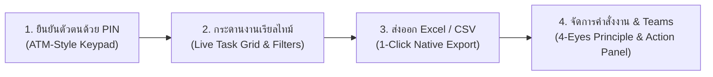
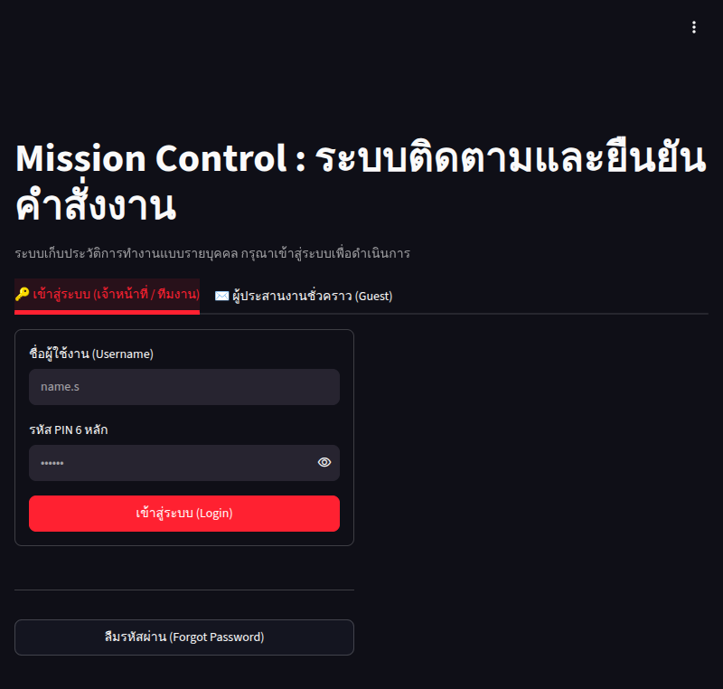
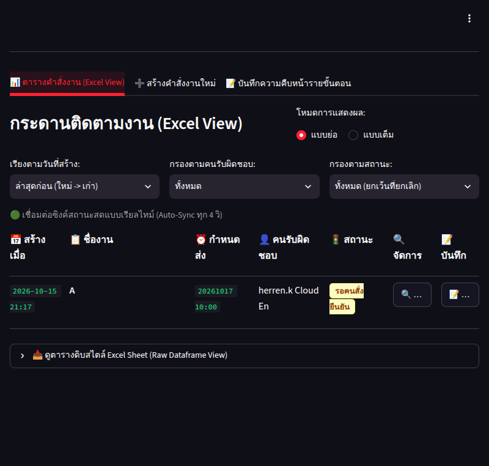
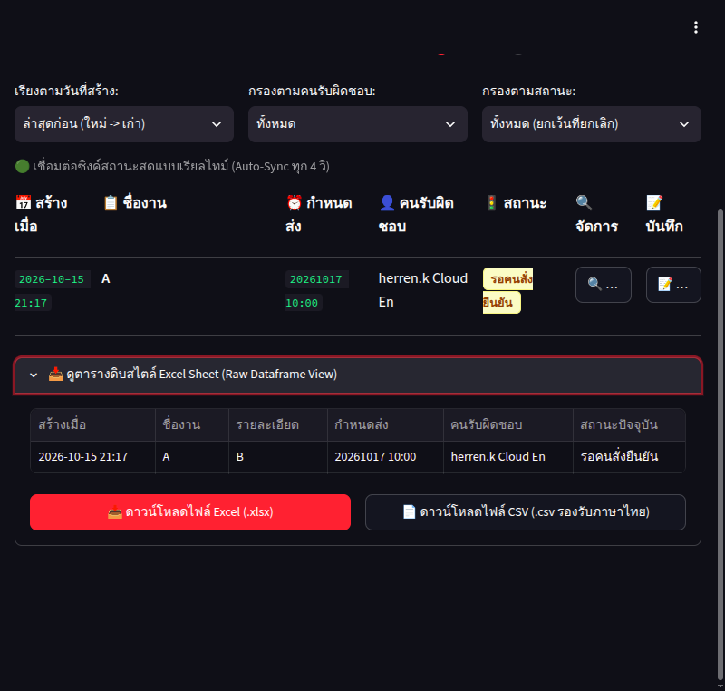
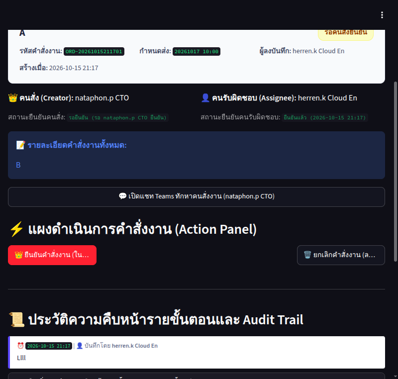

# 📊 Streamlit Mission Control: ระบบติดตามและยืนยันคำสั่งงาน (Executive Visual Walkthrough)

> **Document Class**: Executive Product Walkthrough & User Manual  
> **Production Live URL (Secure 🔒)**: **[https://d1z7r0ybkby2pf.cloudfront.net](https://d1z7r0ybkby2pf.cloudfront.net)**  
> **Infrastructure**: AWS Asia Pacific (Bangkok) + CloudFront Managed SSL  

---

## 🧭 สารบัญการนำเสนอ (Walkthrough Outline)

---

## 1. การยืนยันตัวตนและเข้าสู่ระบบ (Authentication & Identity)

ระบบถูกออกแบบให้เข้าใช้งานได้สะดวกรวดเร็วทั้งบนคอมพิวเตอร์และโทรศัพท์มือถือ โดยใช้รหัส PIN 6 หลักเพื่อความปลอดภัยสูงสุด:

### จุดเด่นเชิงวิศวกรรม (Engineering Highlights):
* **Dual Login Modes**:
  * **🔑 เจ้าหน้าที่ / ทีมงานประจำ**: เลือกรหัสผู้ใช้งาน (เช่น `herren.k`, `nataphon.p`) และกดรหัส PIN 6 หลัก
  * **✉️ ผู้ประสานงานชั่วคราว (Guest)**: รองรับการเข้าใช้งานแบบระบุชื่อ-อีเมล สำหรับบุคคลภายนอกหรือผู้ตรวจรับงานชั่วคราว
* **30-Day SSO Persistent Cookie**: เมื่อล็อกอินสำเร็จแล้ว ระบบจะจดจำเซสชันผ่าน Cookie ปลอดภัย (`st.context.cookies`) ทำให้ไม่ต้องกดรหัส PIN ซ้ำเมื่อเปิดแท็บใหม่
* **Master Reset Mechanism**: หากลืมรหัส PIN สามารถแจ้งรหัสลับ Master Reset Code (`KuromiBlackCat`) ไปยัง Admin เพื่อขอตั้งรหัสผ่านใหม่ได้ทันที

---

## 2. กระดานงานและการติดตามแบบเรียลไทม์ (Live Task Grid & Auto-Sync)

หน้าจอหลักสำหรับติดตามคำสั่งงานทั้งหมดของทีม ออกแบบตามโครงสร้าง Excel View ที่คุ้นเคย พร้อมระบบอัปเดตข้อมูลอัตโนมัติ:

### จุดเด่นเชิงวิศวกรรม (Engineering Highlights):
* **Real-time Heartbeat (`@st.fragment 4s`)**: เมื่อเพื่อนร่วมงานกดยืนยันหรือบันทึกงานในอีกเครื่องหนึ่ง ตารางงานจะอัปเดตให้อัตโนมัติทุก 4 วินาทีโดยที่ผู้ใช้ไม่ต้องกด F5 รีเฟรชหน้าจอ
* **Dual View Mode**:
  * **แบบย่อ (Summary View)**: แสดงเฉพาะหัวข้อ, ผู้รับผิดชอบ, สถานะ, กำหนดส่ง เพื่อการดูภาพรวมที่กระชับ
  * **แบบเต็ม (Full Detail View)**: แสดงรายละเอียดคำสั่งงานทั้งหมด, ผู้สั่งงาน, ผู้บันทึกแทน, และเวลาที่บันทึก
* **Smart Filter Bar**: กรองงานตามสถานะ (รอยืนยัน, กำลังดำเนินการ, รอตรวจสอบ, เสร็จสิ้น) และกรองเฉพาะงานของตนเองได้ในคลิกเดียว

---

## 3. การส่งออกข้อมูลเป็นไฟล์ Excel และ CSV (1-Click Native Export)

ตอบโจทย์การนำข้อมูลไปทำรายงานประจำสัปดาห์หรือส่งต่อให้ผู้บริหาร ด้วยปุ่มดาวน์โหลดไฟล์สำเร็จรูปใต้ตารางข้อมูลดิบ:

### จุดเด่นเชิงวิศวกรรม (Engineering Highlights):
* **📥 1-Click Excel (.xlsx)**: สร้างไฟล์สเปรดชีต Microsoft Excel แท้ผ่านเอนจิน `openpyxl` ในหน่วยความจำ (In-Memory Streaming) พร้อมเปิดใช้งานได้ทันที
* **📄 1-Click CSV (.csv รองรับภาษาไทย)**: ฝังรหัส **UTF-8 with BOM (`utf-8-sig`)** เพื่อป้องกันปัญหาตัวอักษรภาษาไทยเป็นภาษาต่างดาวเมื่อเปิดด้วยโปรแกรม Microsoft Excel บน Windows
* **Zero Dependency on Hover**: ไม่ต้องเอาเมาส์ไปชี้หาไอคอนดาวน์โหลดที่ซ่อนอยู่ มีปุ่มกดชัดเจนขนาดใหญ่ระดับมาตรฐาน Enterprise

---

## 4. แผงควบคุมคำสั่งงานและการเชื่อมต่อ Microsoft Teams (Action Panel & 4-Eyes Principle)

เมื่อคลิกที่ปุ่ม **`🔍 รายละเอียด`** ของแต่ละคำสั่งงาน ระบบจะเปิดหน้าต่าง Action Panel สำหรับการโต้ตอบระหว่างผู้สั่งและผู้รับผิดชอบ:

### จุดเด่นเชิงวิศวกรรม (Engineering Highlights):
* **Bilateral Dual-Confirmation**: คำสั่งงานที่สั่งด้วยวาจา (`รอคนสั่งยืนยัน`) หรือสั่งให้คนอื่น (`รอคนรับผิดชอบตอบรับ`) จะต้องได้รับการกดยืนยันจากทั้งสองฝ่ายก่อน จึงจะสามารถเริ่มงานได้
* **Segregation of Duties (4-Eyes Principle)**: ผู้รับผิดชอบสามารถกด `[🚀 ส่งมอบงาน / ขอส่งงาน]` ได้ แต่**ไม่สามารถกดปิดงานเองได้** ต้องให้ผู้สั่งงานหรือ Admin เป็นผู้ตรวจรับและกด `[✅ ปิดงานสำเร็จ]` เท่านั้น
* **💬 Deep-Link Teams Chat**: มีปุ่มกดเปิดห้องแชตคุยกับคนสั่งงานหรือผู้รับผิดชอบใน Microsoft Teams ได้ทันทีในคลิกเดียว
* **Audit Trail & Step Notes**: บันทึกความคืบหน้าระหว่างทำงาน พร้อมระบบแจ้งเตือนเข้าแชต Teams อัตโนมัติผ่าน Smart Counterparty Routing โดยดึง `recipient_email` จากระบบแบบ Dynamic
