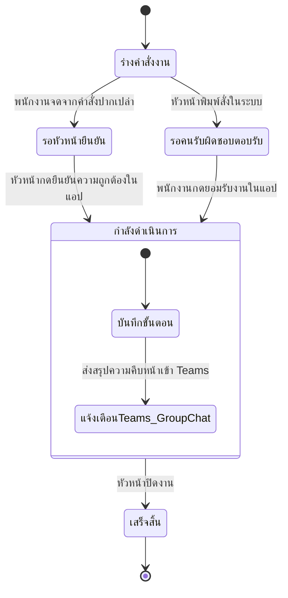

# Mission Control: ระบบติดตามและยืนยันคำสั่งงาน (Order Clarity & Verification System)

## 1. บทสรุปโครงการและวัตถุประสงค์ (System Overview)
ระบบ Mission Control พัฒนาขึ้นด้วย Streamlit เพื่อแก้ปัญหาความคลาดเคลื่อนในการสั่งงาน การลืมคำสั่งปากเปล่า และการไม่อ่านข้อความในแอปพลิเคชันแชต โดยใช้หลักการ **Dual-Confirmation Protocol (การยืนยันแบบสองทาง)** ที่กำหนดให้ทั้ง "คนสั่ง" และ "คนรับผิดชอบ" ต้องกดยืนยันในระบบ จึงจะถือว่าคำสั่งงานมีผลสมบูรณ์ พร้อมเก็บบันทึกประวัติขั้นตอน (Audit Trail) แบบมี Timestamp ตรวจสอบย้อนหลังได้ 100%

---

## 2. ข้อกำหนดทางเทคนิคที่ได้รับการยืนยัน (Confirmed Architecture Specs)

1. **Authentication (ระบบยืนยันตัวตน)**:
   - **6-Digit PIN Code Login**: หัวหน้าและพนักงานเข้าใช้งานด้วยรหัส PIN 6 หลักแยกกัน (เช่น รหัสหัวหน้า `112233`, รหัสพนักงาน `445566`)
   - กำหนดค่าและปรับเปลี่ยนรหัสได้ง่ายผ่าน `secrets.toml`
2. **Notification Delivery (ช่องทางแจ้งเตือน)**:
   - **Microsoft Teams Group Chat**: ส่งการแจ้งเตือนแบบ Adaptive Card เข้ากลุ่มแชตของทีมใน Microsoft Teams ผ่าน Power Automate (Workflows) Webhook
   - มีเมนูทดสอบการส่ง Webhook ในตัวแอป เพื่อตรวจสอบความถูกต้องก่อนเริ่มใช้งานจริง
   - รองรับการแจ้งเตือนสำรองผ่าน Email (SMTP)
3. **Data Storage & Sync (การจัดเก็บข้อมูล)**:
   - **Google Sheets (Cloud Sync)**: ใช้ตาราง Google Sheets 2 แท็บ (`orders` และ `order_logs`) ผ่าน `st-gsheets-connection` ตรวจสอบผ่านมือถือได้ตลอดเวลา
   - **Local Storage Fallback**: มีระบบบันทึกลงไฟล์ Local CSV ในเครื่องอัตโนมัติเมื่อยังไม่ได้เชื่อมต่อ Google Sheets ช่วยให้สามารถทดสอบระบบในเครื่องได้ทันที

---

## 3. สเปกฐานข้อมูล Google Sheets (Data Contracts)

### แท็บที่ 1: `orders` (รายการคำสั่งงานหลัก)
| คอลัมน์              | ชนิดข้อมูล | คำอธิบาย                     | ตัวอย่าง                        |
| :------------------- | :--------- | :--------------------------- | :------------------------------ |
| `order_id`           | String     | รหัสคำสั่งงาน                | `ORD-20261013093000`            |
| `created_at`         | String     | วันเวลาที่สร้างคำสั่ง        | `2026-10-13 09:30`              |
| `task_title`         | String     | ชื่องาน / หัวข้อคำสั่ง       | สรุปรายงานยอดขาย Q3             |
| `description`        | String     | ขอบเขตและรายละเอียดงาน       | จัดทำสไลด์ 5 หน้า แยกตามภูมิภาค |
| `creator`            | String     | คนสั่ง                       | หัวหน้า                         |
| `assignee`           | String     | คนรับผิดชอบ                  | พนักงาน                         |
| `deadline`           | String     | วันเวลากำหนดส่ง              | 2026-10-15 17:00                |
| `creator_confirmed`  | String     | สถานะการยืนยันของคนสั่ง      | ยืนยันแล้ว (2026-10-13 09:35)   |
| `assignee_confirmed` | String     | สถานะการยืนยันของคนรับผิดชอบ | ยืนยันแล้ว (2026-10-13 09:40)   |
| `status`             | String     | สถานะล่าสุดของงาน            | กำลังดำเนินการ                  |

*สถานะงาน (`status`)*:
- `รอหัวหน้ายืนยัน`: พนักงานจดคำสั่งจากคำพูด แล้วรอหัวหน้ามากดยืนยันความถูกต้อง
- `รอคนรับผิดชอบตอบรับ`: หัวหน้าพิมพ์สั่งในระบบ แล้วรอพนักงานกดยอมรับงาน
- `กำลังดำเนินการ`: ทั้งสองฝ่ายกดยืนยันเรียบร้อยแล้ว
- `เสร็จสิ้น`: หัวหน้าปิดงานสมบูรณ์

### แท็บที่ 2: `order_logs` (บันทึกความคืบหน้ารายขั้นตอน)
| คอลัมน์ | ชนิดข้อมูล | คำอธิบาย | ตัวอย่าง |
| :--- | :--- | :--- | :--- |
| `log_id` | String | รหัสบันทึก | `LOG-20261013094500` |
| `order_id` | String | รหัสงานที่เกี่ยวข้อง | `ORD-20261013093000` |
| `timestamp` | String | วันเวลาที่บันทึก | `2026-10-13 11:20` |
| `author` | String | ผู้บันทึกข้อความ | พนักงาน |
| `step_note` | String | ข้อความความคืบหน้า | ได้รับไฟล์ดิบแล้ว อยู่ระหว่างประมวลผล |

---

## 4. วงจรสถานะงานและการยืนยัน (Lifecycle Workflow)



---

## 5. คู่มือการตั้งค่า Microsoft Teams Group Chat Webhook

1. เปิดแอปพลิเคชัน **Microsoft Teams**
2. ไปที่กลุ่มแชต (**Group Chat**) ที่มีคุณและหัวหน้าอยู่ด้วยกัน
3. กดที่จุด 3 จุด (`...`) ด้านบนขวาของหน้าต่างแชต หรือกดไอคอน **Workflows**
4. เลือกหรือค้นหาเทมเพลต: **"Post message in a chat when a webhook request is received"**
   *(หากใช้เมนู Power Automate: เลือก Trigger `When an HTTP request is received` แล้วเลือก Action `Post message in a chat or channel` -> Post as: `Flow bot` -> Post in: `Group chat`)*
5. ตั้งชื่อ Flow เช่น `Mission Control Bot`
6. กด **Save / Create Flow** ระบบจะสร้าง **HTTP POST URL** ให้ทันที
7. คัดลอก URL นั้น นำไปใส่ใน `.streamlit/secrets.toml` ในตัวแปร `webhook_url` ใต้หมวดหมู่ `[teams]`

---

## 6. คู่มือการตั้งค่า Google Sheets

1. เข้าไปที่ [Google Sheets](https://sheets.new) และสร้าง Spreadsheet ใหม่ ตั้งชื่อว่า `mission_control_db`
2. สร้าง 2 แท็บ (Worksheets) ด้านล่าง:
   - แท็บที่ 1: ตั้งชื่อว่า `orders` และใส่ Header คอลัมน์แถวที่ 1:
     `order_id,created_at,task_title,description,creator,assignee,deadline,creator_confirmed,assignee_confirmed,status`
   - แท็บที่ 2: ตั้งชื่อว่า `order_logs` และใส่ Header คอลัมน์แถวที่ 1:
     `log_id,order_id,timestamp,author,step_note`
3. คัดลอก URL ของ Google Sheets จากเบราว์เซอร์ไปใส่ใน `secrets.toml` ใต้หมวดหมู่ `[connections.gsheets]`

---

## 7. คู่มือการรันและทดสอบระบบในเครื่อง (Local Run)

1. เปิด PowerShell แล้วเข้าไปที่โฟลเดอร์โปรเจกต์:
   ```powershell
   cd c:\Users\herre\OneDrive\Antigravity\20261013_0935_Streamlit_Mission_Control
   ```
2. คัดลอกไฟล์ตัวอย่าง secrets:
   ```powershell
   Copy-Item .streamlit/secrets.toml.example .streamlit/secrets.toml
   ```
3. รันแอปพลิเคชัน:
   ```powershell
   streamlit run app.py
   ```
4. ทดสอบล็อกอินด้วย PIN:
   - หัวหน้า: `112233`
   - พนักงาน: `445566`
